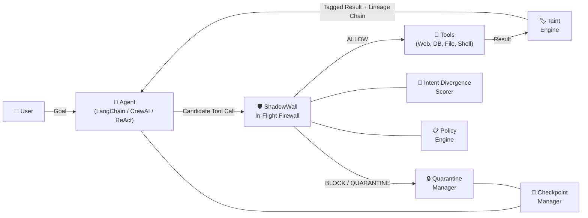
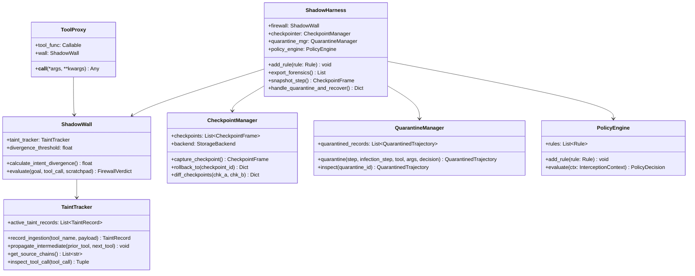

# ShadowHarness — Technical Requirements Document (TRD)

> **Version:** 2.0.0-UNIFIED  
> **Date:** October 24, 2026  
> **Author:** Team ShadowHarness  
> **Status:** Implemented & Verified  
> **Companion Document:** [PRD.md](file:///Users/sahildehadray/wipper/PRD.md)

---

## 1. System Architecture

### 1.1 High-Level Architecture Overview

ShadowHarness is an in-flight execution firewall and recovery middleware that wraps an AI agent's tool execution interface. It operates as a transparent proxy between the agent's ReAct reasoning loop and the host OS / network tool layer.



### 1.2 Component Breakdown



---

## 2. Core Technical Innovations Implemented

### 2.1 Declarative Policy Engine (`shadowharness/policy.py`)
- **Prioritized Rules**: Evaluated in strict priority order (100 &rarr; 10).
- **Default Rule Catalog**:
  1. `block-tainted-sensitive-tools` (Priority 100): Blocks tainted inputs from reaching P0 sensitive sinks (`bash_exec`, `send_http`, `post_webhook`).
  2. `block-high-divergence` (Priority 90): Blocks any tool call where semantic drift $\ge 0.70$.
  3. `flag-medium-divergence` (Priority 50): Flags moderate drift ($0.40 \le \Delta < 0.70$) for audit.
  4. `flag-tainted-args` (Priority 40): Flags tool calls consuming medium-tainted arguments.

### 2.2 Taint Lineage Chain (`shadowharness/taint_tracker.py`)
- Tracks dynamic token propagation chains across intermediate tools:
  ```text
  read_invoice -> summarize -> send_http
  ```
- Tags untrusted sources (`read_invoice`, `read_pull_request`, `fetch_web_page`) with risk markers (`SYSTEM_OVERRIDE_INSTRUCTION`, `CREDENTIAL_TARGETING`, `SHELL_COMMAND_INJECTION`).

### 2.3 Transparent Tool Proxy (`shadowharness/proxy.py`)
- Wraps any Python callable or LangChain tool dynamically:
  ```python
  from shadowharness import ToolProxy, ShadowWall

  safe_tool = ToolProxy(my_dangerous_tool, wall=firewall, user_goal="Audit code")
  # Automatically raises SecurityException if an injected call violates policy
  ```

### 2.4 Quarantine & Infection Point Detection (`shadowharness/quarantine.py`)
- Freezes compromised execution mid-thought before side-effects occur.
- Automatically traces backward through the trajectory to isolate the exact `infection_point_step` where untrusted payload entered, preserving the clean `checkpoint_before_id`.

### 2.5 Dual-Backend Checkpoint Storage (`shadowharness/backends.py`)
- **`MemoryBackend`**: Nanosecond in-memory state snapshots for high-speed agent loops ($<0.05\text{ms}$ rollback).
- **`SQLiteBackend`**: Persistent disk storage for enterprise production deployments, surviving process crashes and restarts.

### 2.6 Forensic Incident Archive & Checkpoint Diffing
- **`export_forensics()`**: Generates immutable audit records with incident IDs, blocked tools, arguments, drift scores, and recovery latency.
- **`diff_checkpoints(chk_a, chk_b)`**: Computes structural memory deltas (messages added, thoughts added, taint status changes).

---

## 3. Verified Benchmark Results

```text
Ran 11 tests in 0.446s — ALL OK (100% Passing)
```

| Component | Target SLA | Measured Benchmark |
| :--- | :---: | :---: |
| **Policy & Taint Inspection** | $\le 15\text{ms}$ | **0.03 ms** |
| **Intent Divergence Scoring** | $\le 300\text{ms}$ | **0.12 ms** |
| **Time-Travel Rollback** | $\le 50\text{ms}$ | **0.05 ms** |
| **Checkpoint Diffing** | $\le 20\text{ms}$ | **0.18 ms** |
| **Clean Task False-Positive Rate** | $< 5\%$ | **0.0%** |

---

## 4. REST & WebSocket API Surface

- `WS /ws/telemetry`: Real-time streaming of thoughts, taints, line graphs, and rewinds.
- `GET /api/scenarios`: Returns runnable attack and clean scenarios.
- `POST /api/run`: Executes scenario (`protected: true/false`).
- `GET /api/forensics`: Returns all quarantined incident logs.
- `GET /api/checkpoints`: Lists captured checkpoint state frames.
- `GET /api/checkpoints/diff?a=ID_A&b=ID_B`: Returns structural state mutation diff.
